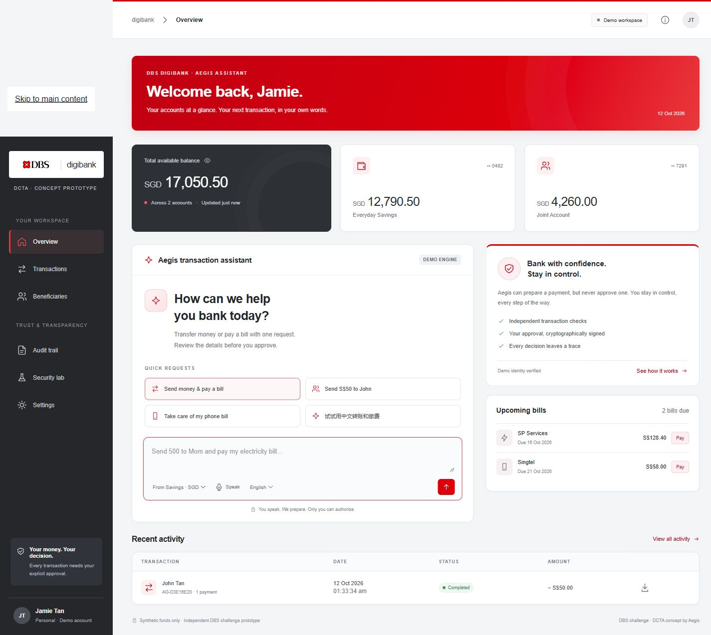

# Aegis — Banking, in your words

面向 DBS Direct Conversational Transaction Agent 赛题的完整本地原型。英文界面，支持中英文输入。核心场景是 **SGD 转账 + 账单支付**。

> AI prepares. You authorize. The gateway verifies.



界面参考 DBS digibank 的红、白、深灰视觉风格。本项目是独立赛题原型，使用模拟资金。

## 快速启动

需要 Node.js 20.10 或更新版本，无第三方运行时依赖，无需 npm install。

Windows 可直接双击 `start-aegis.cmd`，并在使用期间保持该终端窗口开启。关闭窗口或重启电脑后，需要重新启动本地服务；页面本身不会自动运行后端。

```powershell
npm start
```

打开 http://localhost:3000 。如端口被占用：

```powershell
$env:PORT='3001'
npm start
```

开发自动重启：`npm run dev`。检查：`npm run check`。测试：`npm test`。

## 已实现

- 英文响应式银行工作台：余额、账单、联系人、交易记录。
- 中英文文字输入、语音输入入口、可编辑转写。
- 一句话多笔交易、同名收款人消歧、明确账户与金额。
- 独立校验、KYC 状态检查、余额检查、金额与频率限制。
- 独立确认窗口；浏览器生成不可导出的 ECDSA P-256 私钥。
- 后端精确载荷验签、两分钟过期、单次授权、重复提交防护。
- 高金额模拟令牌确认；修改需求使旧计划与授权失效。
- 模拟账本、本地会话持久化、可下载且可离线验签的回执。
- 哈希链审计与 JSON 导出。
- 安全实验室：六个真实运行的隔离攻击测试。
- 可配置的实际模型和录音转写适配器，以及完整的无密钥演示模式。

## 两种运行模式（请在路演中如实说明）

### Demo：开箱即用

默认 `AI_MODE=demo`。使用受限语法解析器与独立证据规则，不会调用大模型。支持：

```text
Send 500 SGD to Mom and pay my electricity bill
Send 50 SGD to John
Send fifty dollars to Mom
Send 50 SGD to Mom from my joint account
Pay my phone bill
给妈妈转500新币，然后交电费
给妈妈转五百新币
```

收款人：Mom / Mei Tan、John Lim、John Tan、Sarah / Sarah Lee。输入 John 必须选择具体对象。默认币种 SGD 和来源账户在输入框旁明确展示。

未支持的请求会要求改写或被阻止，不能把受限离线语法演示宣传成任意自然语言理解。“剩余全部”“如果…就…”、投资、换汇、定时任务、新收款人不执行。

### Live：实际大模型 + 云转写

将 `.env.example` 复制为 `.env`，在自己的机器上填写 API key：

```dotenv
AI_MODE=live
OPENAI_API_KEY=你的密钥
OPENAI_BASE_URL=https://api.openai.com/v1
INTENT_MODEL=gpt-6-astra
VALIDATOR_MODEL=gpt-6-astra
TRANSCRIBE_MODEL=gpt-transcribe
```

重启服务后，Settings 会显示 Live AI。密钥仅在服务端读取，不会发给浏览器。不要把密钥贴进聊天、截图或提交到 Git。

编译器与校验器是两个独立上下文的模型调用，不拥有执行工具。校验器收到原始文本、明确消歧结果、账户与账单上下文和候选计划，检查完整请求。模型错误、超时或没有密钥均停止流程，不静默降级。默认同一模型，两次调用仍有共同失误风险；实际部署可配置不同验证模型。

**当前没有真实 API 凭证，因此真实模型质量、账号可用性、语音效果和延迟尚未实测。** 提供的是完成实现并通过模拟响应测试的接口适配，不代表已完成云端联调。

选型根据 2026-10-11 查询的官方文档：

- [模型目录](https://developers.openai.com/api/docs/models)：GPT-6 Astra 用于复杂推理，优先质量；型号可替换。
- [结构化输出](https://developers.openai.com/api/docs/guides/structured-outputs?api-mode=responses)：使用 Responses API 的严格 JSON Schema。
- [语音转写](https://developers.openai.com/api/docs/guides/transcription)：录音转写接入 `gpt-transcribe`，保留原语言。

没有“对所有语言和场景都最好”的已验证结论。正式录视频前应使用团队真实口音和中英混合指令做评测。

## 语音说明

- 配置 API key：浏览器录音最多 30 秒，最多上传 8 MB，经服务端发给转写服务。转写先放入输入框，由用户检查后发送。
- 未配置 API key：若浏览器支持 Web Speech，使用浏览器语音服务；否则明确提示文字输入。浏览器语音可能联网，不能称为离线 ASR。
- 麦克风需要用户授权。使用 localhost 或 HTTPS 安全上下文。
- 云转写录音保存在本地 `data/*.audio`，对应记录中保留 MIME、哈希和转写。只使用合成／测试数据。

## 安全边界

真实实现：精确交易内容绑定、非对称签名、服务端验签、过期拒绝、重放拒绝、执行时重查策略、会话隔离、同源检查、CSP、哈希链审计。

模拟部分：身份和 KYC、银行账本、生物识别、额外验证令牌。浏览器点击触发签名不等同于 Face ID 或硬件令牌。高额令牌展示在同一页面，不是真实带外通道。公钥注册没有真实银行身份绑定。

后端是单进程本地开发服务，默认仅监听回环地址，并校验 Host 与 Origin。不要直接暴露公网。生产需要独立原生授权界面、银行身份认证、硬件密钥、服务隔离、数据库事务、持久化幂等、TLS、速率限制、监控和隐私保留策略。更多内容见 [安全说明](docs/SECURITY.md)。

## 账本与审计

- 所有金额使用整数分，不使用浮点金额运算。
- 每份计划最多 5 笔；单份总额最高 S$5,000；每日最高 S$10,000；每分钟最多 5 笔。
- 超过 S$2,000 要求模拟第二验证；所有计划最终都需要签名。
- 模拟账本在全部检查通过后同步提交整批交易；真实银行可能产生部分成功，不能直接沿用此假设。
- 会话持久化到 `data/<session-id>.json`，浏览器私钥保存于 IndexedDB。刷新会恢复计划和余额。
- Reset 创建新会话，保留旧审计文件。cookie 不用于真实身份认证。
- 哈希链可以发现未同步重算的内容篡改，但没有外部锚定，不能声称抵御服务器管理员重写整个日志。

下载回执后，可以离线验证：

```powershell
node scripts/verify-receipt.mjs C:/path/to/AG-XXXXXXXX.json
```

工具验证签名和回执内容的一致性，不证明真实银行身份或法律上的不可否认性。

## 目录

```text
public/                 界面、样式、浏览器签名与语音
server/catalog.mjs      合成账户、收款人、账单与策略
server/parser.mjs       离线解析与独立证据规则
server/provider.mjs     实际模型与语音适配
server/engine.mjs       状态机、策略、授权、账本、审计
server/lab.mjs          隔离安全攻击实验
server/index.mjs        HTTP 边界与本地持久化
tests/                  核心逻辑、HTTP、模型适配测试
scripts/                回执离线验签工具
docs/                   架构、安全、评测、演示与提交材料
```

## 参赛准备

阅读 [演示脚本](docs/DEMO.md)、[架构](docs/ARCHITECTURE.md)、[提交草稿](docs/SUBMISSION.md) 和 [验收记录](docs/QA.md)。

项目目前没有 CodeBuddy／WorkBuddy 使用证据。官方要求至少实际使用其一并提供开发记录；必须通过后续真实开发、调试或测试过程补齐，不应伪造。尚未录制演示视频或发布在线版本。
