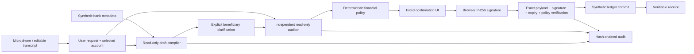
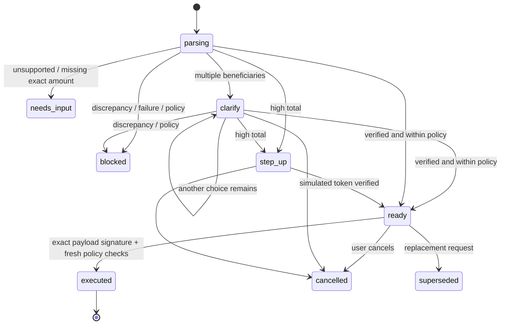

# Architecture

## Request path

## Plan state machine

## Trust boundaries

1. **Input and metadata:** untrusted data, never instructions to alter system behavior.
2. **Compiler and validator:** text in / constrained data out. No execution tools, private keys, API credentials for financial writes, or ability to set user approval.
3. **Application policy:** authoritative recipient lookup; integer cents; bill amount check; KYC, balance, plan/day/velocity limits.
4. **User confirmation:** deterministic template from immutable server-issued payload. IndexedDB holds a non-extractable private CryptoKey. This is a demo surface in the same origin, not secure bank-native UI.
5. **Gateway:** registered public key; exact server-issued bytes; scope, session, version, expiry, action hash; single-use state. Policy is rechecked at commit.
6. **Ledger:** all checks precede a synchronous in-memory batch commit; serialized per-session HTTP mutations. JSON is persisted by temp-file rename after each mutating request. This is not a distributed transactional database.

## Signature envelope

`domain`, `sessionId`, `planId`, `version`, `nonce`, `expiresAt`, `actions`, `total` are serialized by the server. The browser signs these exact UTF-8 bytes with ECDSA P-256 / SHA-256. Node verifies IEEE-P1363 encoding. No independent JSON reserialization is used at verification.

Actions bind recipient id/name/account suffix, source, currency, integer-cent amount and evidence. The server also compares actions to its validated hash. Issuing a new challenge invalidates the prior one. Executed, cancelled or superseded plans cannot reuse approval.

## API surface

| Method / path | Purpose |
|---|---|
| GET `/api/health` | Development health |
| GET `/api/state` | Current synthetic workspace |
| POST `/api/plan` | Compile and audit a draft; cannot debit |
| POST `/api/clarify` | Resolve only an offered beneficiary |
| POST `/api/key` | Register session's demo public key once |
| POST `/api/challenge` | Issue exact authorization payload |
| POST `/api/execute` | Sole ledger write entry point |
| POST `/api/cancel` | Invalidate a plan |
| POST `/api/step-up` | Simulated high-value verification |
| POST `/api/transcribe` | Audio transcription, max 8 MB |
| GET `/api/audit` | Export session audit |
| POST `/api/lab` | Run isolated synthetic security checks |
| POST `/api/kyc` | Explicitly simulated identity status |
| POST `/api/reset` | Create a fresh sandbox |

Mutating browser calls require an exact matching Origin. JSON endpoints require application/json. Cookie is HttpOnly / SameSite=Strict. Static files are explicitly allowlisted; server source and .env cannot be served.

## Why no framework dependency?

The deliverable is a focused local hackathon prototype. Native Node HTTP, crypto and test APIs keep setup reproducible and avoid dependency installation. Browser modules, CSS and Web Crypto provide the UI and signing. Separation is by small domain modules, not a single mock front-end file. For multiple developers and a larger product, migrate the presentation layer independently; the transaction engine can remain behind a versioned API.

## Production migration

Replace synthetic identity with bank-authenticated identity; client registration with identity-bound hardware credentials; modal with trusted native signing UI; JSON state with transactional storage and durable idempotency; same-process gateway with isolated credentials/services; hash chain with append-only storage and external anchors. Define partial-success semantics for real bank batch execution before integrating payment APIs.
